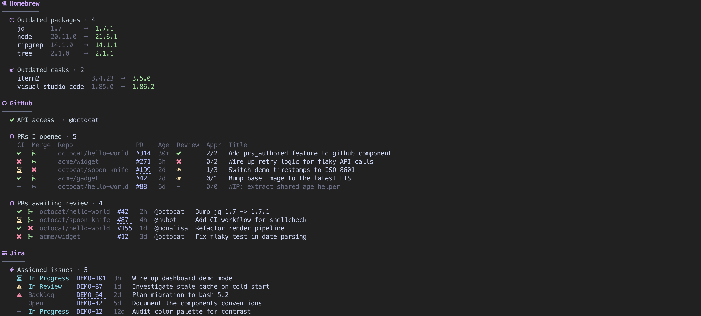

# cli-dashboard

Personal CLI dashboard. Bash. macOS + brew only. Refreshes itself.



## Install

```bash
brew install coreutils gh git jq ankitpokhrel/jira-cli/jira-cli
```

`requirements.sh` prints the exact command if anything is missing.

## Env vars

```bash
export GH_TOKEN="<github token>"
export JIRA_API_TOKEN="<atlassian api token>"
export JIRA_HOST="https://<your-org>.atlassian.net"
jira init   # one-time, writes ~/.config/.jira/.config.yml
```

## Run

Check out the latest release tag to make full use of the new version available feature — sitting on the tag keeps the in-dashboard version indicator discreet (running on `master` past a tag flags as outdated).

```bash
git clone https://github.com/JReko/cli-dashboard.git
cd cli-dashboard
git checkout "$(git tag --sort=-v:refname | head -n 1)"
./dashboard.sh
```

Upgrade: `git fetch --tags && git checkout "$(git tag --sort=-v:refname | head -n 1)"`.


## Configure

Defaults live in `config.sh`. For personal tweaks, create `config.local.sh`
next to it — it's gitignored and sourced last, so anything you set there
overrides the defaults without dirtying `git status`.

```bash
# config.local.sh
DASHBOARD_REFRESH_MINUTES=1
COMPONENT_JIRA=false
```

Toggles:

- `DASHBOARD_REFRESH_MINUTES` — refresh interval (`0` = render once, exit)
- `DASHBOARD_REFRESH_TIMEOUT_SECONDS` — per-cycle deadline for a component
  (`0` = no deadline)
- `DASHBOARD_DEMO=true|false` — render mock payloads instead of hitting APIs
- `COMPONENT_<NAME>=true|false` — enable/disable a component
- `FEATURE_<COMPONENT>_<NAME>=true|false` — enable/disable a single feature
- `DASHBOARD_WIDE_COLUMNS` — terminal width (cols) at/above which the panels
  split into two columns: GitHub left, Jira + Homebrew stacked right (default `140`)
- `DASHBOARD_MAIN_PERCENT` — share of the width the left column gets in wide mode
  (default `55`)
- `DASHBOARD_FIT_HEIGHT=true|false` — trim table rows so the whole frame fits the
  terminal height, hidden rows shown as `+N more` (default `true`)
- `BREW_COMPACT=true|false` — Homebrew as one inline line per feature instead of
  the version table (default `false`)
- `PULSE_HISTORY_FILE` — where the review-queue trend is kept (default
  `~/Library/Caches/cli-dashboard/review_history`)

Honors `NO_COLOR=1` and `UI_NO_NERDFONT=1`.

## Look

Each component is a rounded panel, title set in the border, status badge on
the right (e.g. `✔ @octocat`). Order is by urgency: the Pulse strip, GitHub
(review requests, then my PRs), Jira, Homebrew last.

- **Fits one window.** Pulse spans the top. On terminals ≥
  `DASHBOARD_WIDE_COLUMNS` GitHub takes the left column and Jira + Homebrew
  stack on the right; narrower, everything stacks. Size is read from the tty
  (`stty size`), so it's right even inside the refresh loop. Long titles
  truncate with `…`. Resizing (`SIGWINCH`) re-renders at the new size.
- **Height-aware.** With `DASHBOARD_FIT_HEIGHT`, tables are trimmed to a shared
  row cap so nothing scrolls off; leftover lines go back in priority order
  (GitHub first). Hidden rows show as `+N more`; a table cut to zero rows keeps
  only its feature header and count.
- **Quiet by default.** Healthy state is muted; only problems get color
  (failing CI, conflicts, changes requested). Ages go yellow → red as they
  get stale.
- **Empty sections collapse** to one muted `Title · none` line.
- **Words over icons.** PR tables have one `State` column in plain words
  (`CI failing`, `conflict`, `ready to merge`, `1/3 approved`, `draft`);
  healthy rows leave it blank. Pulse bars run green → yellow → red as they
  fill (btop-style).

## Pulse

A full-width strip on top that sums up the rest:

| Meter               | Value                 | Bar full at | Caption              |
| ------------------- | --------------------- | ----------- | -------------------- |
| PRs to review       | review requests       | 8           | age of the oldest    |
| My PRs blocked      | blocked PRs           | all open    | of N open · N ready  |
| Jira in progress    | in-progress tickets   | 4           | stale (> 7d) count   |
| Brew outdated       | formulae + casks      | 20          | major-bump count     |

Meters sit in one row; too narrow for that, they become a list. Right of
the meters, when there's room (dropped otherwise): the review queue over 14 days as a
sparkline, today highlighted, once at least 3 days are recorded (hidden
before that). Each refresh overwrites today's line in
`PULSE_HISTORY_FILE`; days the dashboard didn't run show empty. Demo mode
uses a fixed series and writes nothing.

Pulse fetches nothing. Features publish numbers with `ui_metric <key> <value>`
(a marker line the dashboard strips from the panel); once every worker is in,
the dashboard gathers them into `PULSE_METRICS` and renders the strip. A meter
whose source is off or failed is dropped, not shown as zero. Toggles:
`COMPONENT_PULSE`, `FEATURE_PULSE_METERS`, `FEATURE_PULSE_TREND`.

## Refresh

Refreshes run in the background. Every component is fetched and rendered in its
own subprocess, in parallel, while the frame already on screen stays put — so a
refresh never blanks the dashboard and never leaves it half-updated. Only the
status bar moves while a cycle is in flight:

```text
⠹ Refreshing 2/4 sources · Updated 09:12:04 · refresh every 5m · v1.2.0
```

When every component has reported, the whole frame is swapped in one repaint.

Failures are named in the status bar; the offending section keeps its own error
line, and the full output goes to `~/Library/Logs/cli-dashboard/dashboard.log`.

```text
Updated 09:17:04 · refresh every 5m · ⚠ jira failed          # some sources
Updated 09:17:04 · refresh every 5m · ✗ all 4 sources failed  # every source
```

A component that hasn't reported within `DASHBOARD_REFRESH_TIMEOUT_SECONDS` is
killed and counted as failed, so one wedged CLI can't freeze the dashboard.

## Version indicator

The status bar appends the running version (from `git describe --tags`) and
compares it to the latest GitHub release. On the latest tag it stays discreet;
when behind it shows `⚠ <current> → <latest>`. Toggle with
`COMPONENT_VERSION` / `FEATURE_VERSION_UPDATE_CHECK`.

## Columns

Both GitHub tables drop the most common repo owner (`acme/widget` → `widget`);
other owners stay visible. When a title doesn't fit, Repo (and Author) are
truncated first, down to 14 chars, before the title gives up any width.

### Awaiting my review

Oldest first. Age: yellow > 1d, red > 3d.

| Column | Meaning |
| ------ | ------- |
| State  | red `CI failing` · red `conflict` · cyan `CI running` · blank when healthy |

Publishes `review_count`, `review_oldest_secs`.

### My PRs

Sorted by what needs me: blocked (changes requested / failing CI / conflict)
→ ready to merge → waiting → drafts. Newest first within a group. Age: yellow
> 3d, red > 7d. Drafts are fully dimmed.

| Group    | State |
| -------- | ----- |
| blocked  | red `changes requested` · `CI failing` · `conflict` |
| ready    | green `ready to merge` |
| waiting  | cyan `CI running`, else `1/3 approved` · `awaiting review` · yellow `no reviewers` |
| draft    | muted `draft` |

State shows the most important reason; more are counted (`CI failing +1`).

Publishes `mine_total`, `mine_blocked`, `mine_ready`.

Ready/blocked use `reviewDecision` when branch protection requires reviews,
otherwise approvals and pending review requests.

### Jira assigned issues

In progress first, then to-do, then the rest. Keys are clickable (OSC 8). A
stacked bar above the table splits the tickets by status, with a legend.
Publishes `wip_count`, `wip_stale`.

`jira issue list --raw` returns status names only, no status category, so a
second query (`statusCategory = "In Progress"`, keys only) tells in-progress
apart from to-do.

| Column | Meaning |
| ------ | ------- |
| P      | `⇈` highest (red) · `↑` high (yellow) · `=` medium · `↓` low; hidden when every row is medium/unset |
| Status | cyan in progress · green done · muted otherwise |
| Age    | since last update; yellow > 7d, red > 14d (in-progress only) |

### Homebrew

`name  installed → latest  major`: major-version bumps are yellow and tagged.
Publishes `brew_formulae_outdated` / `_major`, `brew_casks_outdated` / `_major`.

`UI_NO_NERDFONT=1` swaps glyphs for ASCII (`OK`, `KO`, `RV`, `^^`, `^`, `v`, bars `==--`, legend boxes `x`/`o`).

## Layout

```
dashboard.sh          entry point, status bar, refresh loop + painting
config.sh             toggles
requirements.sh       startup dep + env validation
lib/refresh.sh        background refresh engine (one subprocess per component)
lib/ui.sh             colors, icons, spinner, screen control, panels, ui_table,
                      truncation, age coloring, bars/sparklines, ui_metric
lib/log.sh            append-only error log + JSON payload guard
lib/demo.sh           fake payloads used when DASHBOARD_DEMO=true
components/<name>/
  <name>.sh           orchestrator: sources features, exposes <name>_render
  <feature>.sh        one feature, one public <component>_<feature>_check fn
components/pulse/     summary strip, built from other components' ui_metric
```

## Add a component

1. `mkdir components/<name>`
2. Create `components/<name>/<feature>.sh` — public fn `<name>_<feature>_check`. Print a `ui_feature_header`, then rows (cells via `ui_cell`, tab-separated) piped into `ui_table`; fit to `$UI_WIDTH` (`ui_table` marks its header and rows so the dashboard can trim them to fit the height; column spec `Name[:r][:flex][:shrink]`: one `flex` column takes leftover width, `shrink` columns give theirs up to it first). On failure print `ui_feature_error`
3. Create `components/<name>/<name>.sh` — calls `ui_panel_title` (and optionally `ui_panel_badge`), sources feature(s), gates each with `config_enabled FEATURE_<NAME>_<FEATURE>`, collects their exit status and returns non-zero if any failed (that's what the status bar flags)
4. Add `COMPONENT_<NAME>=true` and `FEATURE_<NAME>_<FEATURE>=true` to `config.sh`
5. Source the orchestrator from `dashboard.sh` and add `<name>:<name>_render` to `dashboard_register_components` gated on `COMPONENT_<NAME>`, with a `DASHBOARD_COLUMN[<name>]` (`1` = left, `2` = right on wide terminals; same number stacks). Anything it writes to stdout is the section; stderr is treated as a leak and logged
6. If new external CLI / env var: add to `requirements.sh`
7. Add a `demo_<name>_<feature>_payload` mock to `lib/demo.sh` and branch the feature on `config_enabled DASHBOARD_DEMO`
8. Optional: publish numbers with `ui_metric` and add a meter in `components/pulse/meters.sh`
9. `shellcheck -x dashboard.sh config.sh requirements.sh lib/*.sh components/**/*.sh`
